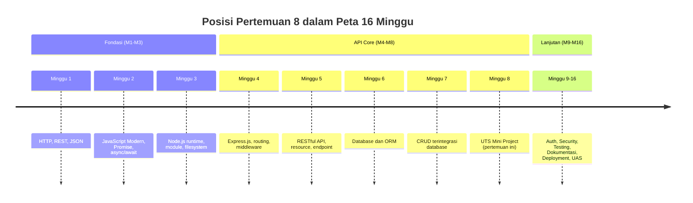
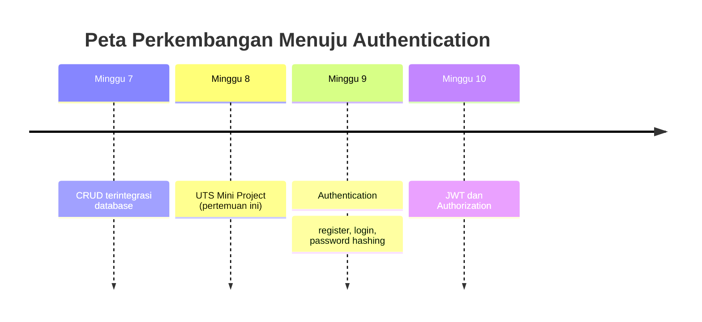

# Pertemuan 8 — UTS: Mini Project Backend

| | |
|:--|:--|
| **Minggu** | 8 |
| **Tanggal** | Senin, 2 November 2026 (SI-VA) / Selasa, 3 November 2026 (SI-VB) |
| **CPMK** | CPMK117 |
| **Model Pembelajaran** | Case Based Learning / Problem Based Learning |
| **Stack** | Node.js 20+, Express.js 5, Prisma ORM 7, SQLite |

> **Catatan penting:** Pertemuan 8 adalah **Ujian Tengah Semester (UTS)** dalam bentuk **mini project backend**. Tidak ada materi baru yang diajarkan; pertemuan ini mengevaluasi penerapan materi Minggu 1–7 secara utuh. Setiap mahasiswa (atau kelompok kecil) mempresentasikan mini project backend yang dibangun dari domain yang dipilih sendiri, dengan REST API yang terintegrasi database melalui Prisma ORM. Pertemuan ini menjadi penanda akhir fase **API Core (M2)** sebelum memasuki fase **Keamanan & Keandalan (M4)** pada Minggu 9.

---

## Daftar Isi

- [Pertemuan 8 — UTS: Mini Project Backend](#pertemuan-8--uts-mini-project-backend)
  - [Daftar Isi](#daftar-isi)
  - [1. Keterkaitan Pertemuan dengan RPS OBE](#1-keterkaitan-pertemuan-dengan-rps-obe)
  - [2. Capaian Pembelajaran Pertemuan](#2-capaian-pembelajaran-pertemuan)
  - [3. Pemantik Kasus: Dari Latihan ke Project](#3-pemantik-kasus-dari-latihan-ke-project)
  - [4. Ruang Lingkup Mini Project](#4-ruang-lingkup-mini-project)
    - [4.1 Batasan Wajib](#41-batasan-wajib)
    - [4.2 Batasan Opsional (Nilai Tambahan)](#42-batasan-opsional-nilai-tambahan)
  - [5. Persiapan Teknis Sebelum UTS](#5-persiapan-teknis-sebelum-uts)
    - [5.1 Struktur Project](#51-struktur-project)
    - [5.2 Perintah Menyiapkan dan Menjalankan](#52-perintah-menyiapkan-dan-menjalankan)
    - [5.3 Verifikasi Cepat](#53-verifikasi-cepat)
  - [6. Alur Presentasi dan Pengujian](#6-alur-presentasi-dan-pengujian)
  - [7. Kriteria Kelayakan (Definition of Done)](#7-kriteria-kelayakan-definition-of-done)
  - [8. Case Based Learning: Studi Kasus Domain](#8-case-based-learning-studi-kasus-domain)
    - [8.1 Domain Perpustakaan](#81-domain-perpustakaan)
    - [8.2 Domain Laboratorium](#82-domain-laboratorium)
    - [8.3 Domain E-Warung](#83-domain-e-warung)
  - [9. Aktivitas Kelompok](#9-aktivitas-kelompok)
  - [10. Latihan Individu](#10-latihan-individu)
  - [11. Pemanfaatan AI sebagai Coding Assistant](#11-pemanfaatan-ai-sebagai-coding-assistant)
  - [12. Kuis Formatif](#12-kuis-formatif)
  - [13. Output Pembelajaran — UTS Mini Project](#13-output-pembelajaran--uts-mini-project)
    - [Cara Pengumpulan — Push ke Repository GitHub Kelas](#cara-pengumpulan--push-ke-repository-github-kelas)
  - [14. Rubrik UTS](#14-rubrik-uts)
  - [15. Persiapan menuju Pertemuan 9](#15-persiapan-menuju-pertemuan-9)
  - [Lampiran: Kode Referensi](#lampiran-kode-referensi)

---

## 1. Keterkaitan Pertemuan dengan RPS OBE

Pertemuan 8 menutup fase **API Core** pada **CPMK117**:

> Mahasiswa mampu membangun REST API Express.js yang terintegrasi dengan database menggunakan ORM.

Selama Minggu 1–7, Anda membangun kemampuan secara bertahap: memahami HTTP dan REST (Minggu 1), menulis JavaScript modern (Minggu 2), menjalankan server Node.js (Minggu 3), membangun endpoint Express.js (Minggu 4), merancang RESTful API (Minggu 5), menghubungkan database melalui Prisma ORM (Minggu 6), dan merapikan CRUD dengan pola service/controller (Minggu 7). Pertemuan ini menguji apakah kemampuan tersebut dapat disusun menjadi satu aplikasi backend yang utuh, berjalan, dan dapat dipertanggungjawabkan.



---

## 2. Capaian Pembelajaran Pertemuan

Setelah mengikuti pertemuan ini, mahasiswa mampu:

| No. | Kemampuan | Indikator |
| :-: | --------- | --------- |
| 1 | Menyusun REST API utuh | Menjalankan mini project yang memuat resource utama dengan operasi CRUD lengkap |
| 2 | Mengintegrasikan database | Menunjukkan data tersimpan dan terbaca dari database SQLite melalui Prisma ORM |
| 3 | Menerapkan pola berlapis | Menjelaskan pembagian tanggung jawab route, controller, dan service pada project |
| 4 | Menguatkan validasi input | Menunjukkan validasi tipe dan rentang pada endpoint write yang menolak data tidak valid |
| 5 | Memilih kode status yang tepat | Mengirim `201`, `404`, `204`, `400`, dan `500` sesuai kondisi |
| 6 | Mempresentasikan dan membela desain | Menjelaskan keputusan arsitektur dan menjawab pertanyaan pengujian secara lisan |

---

## 3. Pemantik Kasus: Dari Latihan ke Project

Selama tujuh pertemuan, Anda mengerjakan latihan terpisah: server HTTP, service in-memory, endpoint Express, dan CRUD buku. Masing-masing berjalan, tetapi belum pernah disusun menjadi satu aplikasi yang utuh.

Perhatikan perbedaan berikut:

| Aspek | Latihan per pertemuan | Mini project UTS |
|:------|:----------------------|:-----------------|
| Domain | Diberikan (buku, pengguna) | Dipilih sendiri |
| Resource | Satu resource | Satu resource utama + relasi opsional |
| Struktur | Datar atau setengah lapis | Berlapis penuh (route, controller, service) |
| Database | Kosong atau seed kecil | Berisi data hasil operasi |
| Validasi | Sebagian endpoint | Semua endpoint write |
| Bukti | Kode berjalan | Kode berjalan + presentasi + pengujian |

Pertanyaan untuk dibahas bersama:

1. Resource apa yang akan Anda bangun, dan field apa saja yang wajib serta opsional?
2. Bagaimana Anda memastikan setiap endpoint write menolak data yang tidak valid?
3. Bukti apa yang Anda siapkan agar dosen dapat memverifikasi bahwa data benar-benar tersimpan di database, bukan di memori?

Pertemuan ini menjawab pertanyaan tersebut melalui ruang lingkup project, kriteria kelayakan, dan alur pengujian yang terstruktur.

---

## 4. Ruang Lingkup Mini Project

Mini project UTS adalah **backend REST API** dengan batasan berikut.

### 4.1 Batasan Wajib

1. **Satu resource utama** dari domain yang Anda pilih (perpustakaan, laboratorium, e-warung, absensi, atau domain lain yang disetujui).
2. **Empat operasi CRUD** pada resource utama: `GET` (daftar), `GET` (detail), `POST`, `PATCH` atau `PUT`, dan `DELETE`.
3. **Integrasi database** melalui Prisma ORM dan SQLite — data harus bertahan setelah server di-restart.
4. **Pola berlapis**: `src/routes/`, `src/controller/`, dan `src/service/` terpisah.
5. **Validasi input** pada semua endpoint write (POST, PATCH/PUT) dengan gerbang `typeof` dan pengecekan rentang.
6. **Kode status yang tepat**: `201` untuk create, `404` untuk tidak ditemukan, `204` untuk delete, `400` untuk validasi gagal, `500` untuk error server.
7. **Middleware 404 dan error handler** di `app.ts`.
8. **README** yang memuat cara menjalankan, struktur lapisan, dan contoh `curl` tiap endpoint.

### 4.2 Batasan Opsional (Nilai Tambahan)

- Relasi antar resource (mis. `pinjaman` merujuk `buku` dan `pengguna`).
- Filter query pada endpoint daftar (mis. `?status=aktif`).
- Endpoint `GET /health` untuk health check.
- Seed data awal melalui `prisma/seed.ts`.

> **Catatan:** Batasan opsional tidak wajib, tetapi dapat meningkatkan nilai pada komponen "kelengkapan fitur" dalam rubrik. Prioritaskan batasan wajib terlebih dahulu.

---

## 5. Persiapan Teknis Sebelum UTS

Sebelum hari UTS, pastikan project Anda memenuhi langkah berikut. Setiap langkah dapat diverifikasi dengan perintah yang tercantum.

### 5.1 Struktur Project

```text
mini-project/
├── app.ts                    # menyusun middleware, route, 404, error handler
├── server.ts                 # menjalankan app + shutdown bersih
├── client.ts                 # instance Prisma Client (singleton)
├── prisma/
│   ├── schema.prisma         # skema model resource
│   └── migrations/           # hasil prisma migrate
├── prisma.config.ts
├── .env.example              # template environment (DATABASE_URL, PORT)
├── package.json
├── tsconfig.json
├── README.md
└── src/
    ├── routes/
    │   └── <resource>.routes.ts
    ├── controller/
    │   └── <resource>.controller.ts
    └── service/
        └── <resource>.service.ts
```

### 5.2 Perintah Menyiapkan dan Menjalankan

```bash
cd mini-project
npm install
cp .env.example .env
npx prisma migrate dev --name init
npx prisma generate
npm start
```

### 5.3 Verifikasi Cepat

Jalankan perintah berikut pada terminal lain dan pastikan hasilnya sesuai:

```bash
# 1. Health check (bila tersedia)
curl -i http://localhost:3008/health

# 2. Ambil daftar resource
curl -i http://localhost:3008/<resource>

# 3. Buat data baru — harus 201
curl -i -X POST http://localhost:3008/<resource> \
  -H "Content-Type: application/json" \
  -d '{ ... }'

# 4. Detail data — harus 200; id tidak ada — harus 404
curl -i http://localhost:3008/<resource>/1
curl -i http://localhost:3008/<resource>/999999

# 5. Update sebagian — harus 200
curl -i -X PATCH http://localhost:3008/<resource>/1 \
  -H "Content-Type: application/json" \
  -d '{ ... }'

# 6. Hapus — harus 204
curl -i -I -X DELETE http://localhost:3008/<resource>/1

# 7. Validasi gagal — harus 400
curl -i -X POST http://localhost:3008/<resource> \
  -H "Content-Type: application/json" \
  -d '{ ... data tidak valid ... }'
```

> **Kesalahan umum:** project berjalan di komputer Anda tetapi gagal di komputer lain karena `.env` atau file `.db` ikut ter-commit. Pastikan `node_modules`, `.env`, dan file `.db` tidak disertakan dalam commit (lihat bagian Git di [§13](#13-output-pembelajaran--uts-mini-project)).

---

## 6. Alur Presentasi dan Pengujian

Setiap kelompok mempresentasikan mini project selama **10 menit** dengan susunan berikut:

| Tahap | Durasi | Isi |
|:------|:-------:|:----|
| 1. Pembukaan | 1 menit | Nama anggota, domain, dan tujuan project |
| 2. Arsitektur | 2 menit | Struktur lapisan, skema database, dan alur request |
| 3. Demo live | 4 menit | Menjalankan server dan menguji tiap endpoint dengan `curl` |
| 4. Penutup | 1 menit | Kendala yang dihadapi dan rencana pengembangan |
| 5. Tanya jawab | 2 menit | Dosen menguji pemahaman |

```mermaid
sequenceDiagram
    P as Presenter
    S as Server (npm start)
    C as curl / Postman
    D as SQLite

    P->>S: npm start
    S-->>P: API berjalan di http://localhost:3008
    P->>C: POST /<resource> (data valid)
    C->>S: request
    S->>D: INSERT
    D-->>S: id baru
    S-->>C: 201 + JSON
    P->>C: GET /<resource>
    C->>S: request
    S->>D: SELECT
    D-->>S: data
    S-->>C: 200 + JSON
    P->>C: POST /<resource> (data tidak valid)
    C->>S: request
    S-->>C: 400 + daftar error
    P->>C: DELETE /<resource>/1
    C->>S: request
    S->>D: DELETE
    S-->>C: 204
```

> **Catatan:** Demo harus dijalankan langsung dari repository yang di-push, bukan dari folder lokal yang berbeda. Dosen dapat meminta Anda menjalankan ulang `npm install` dan `npx prisma migrate dev` untuk memastikan project dapat direproduksi.

---

## 7. Kriteria Kelayakan (Definition of Done)

Project dianggap **lulus** bila seluruh kriteria berikut terpenuhi. Kriteria ini menjadi dasar penilaian minimum sebelum komponen nilai tambahan dihitung.

| No. | Kriteria | Cara Verifikasi |
| :-: | -------- | --------------- |
| 1 | Server berjalan tanpa error | `npm start` menampilkan pesan "API berjalan" |
| 2 | Database ter-migrate | `npx prisma migrate dev` berhasil tanpa error |
| 3 | CRUD lengkap | Kelima endpoint resource utama merespons dengan status yang benar |
| 4 | Data persisten | Data yang dibuat masih ada setelah server di-restart |
| 5 | Validasi berfungsi | POST dengan data tidak valid mengembalikan `400` |
| 6 | Pola berlapis | File route, controller, dan service terpisah |
| 7 | README lengkap | Memuat cara menjalankan, struktur, dan contoh `curl` |
| 8 | Git bersih | `node_modules`, `.env`, dan `.db` tidak ter-commit |

> **Kesalahan umum:** data tersimpan di array in-memory, bukan di database. Saat server di-restart, data hilang. Pastikan setiap operasi memanggil Prisma Client, bukan variabel global.

---

## 8. Case Based Learning: Studi Kasus Domain

Dosen menyediakan tiga contoh domain sebagai acuan. Anda dapat memilih salah satu atau mengusulkan domain lain yang setara.

### 8.1 Domain Perpustakaan

Resource utama: `buku`. Relasi opsional: `pinjaman` (merujuk `buku` dan `pengguna`).

| Field | Tipe | Wajib | Catatan |
|:------|:-----|:------:|:--------|
| `id` | Int | — | autoincrement |
| `judul` | String | Ya | bukan kosong |
| `penulis` | String | Ya | bukan kosong |
| `tahun` | Int | Ya | rentang 1000–2100 |
| `stok` | Int | Tidak | default 0, minimal 0 |

### 8.2 Domain Laboratorium

Resource utama: `peralatan`. Relasi opsional: `peminjaman`.

| Field | Tipe | Wajib | Catatan |
|:------|:-----|:------:|:--------|
| `id` | Int | — | autoincrement |
| `nama` | String | Ya | bukan kosong |
| `kode` | String | Ya | unik |
| `kondisi` | String | Ya | enum: baik, rusak, perbaikan |
| `jumlah` | Int | Tidak | default 1, minimal 1 |

### 8.3 Domain E-Warung

Resource utama: `menu`. Relasi opsional: `pesanan`.

| Field | Tipe | Wajib | Catatan |
|:------|:-----|:------:|:--------|
| `id` | Int | — | autoincrement |
| `nama` | String | Ya | bukan kosong |
| `harga` | Int | Ya | minimal 0 |
| `kategori` | String | Ya | bukan kosong |
| `tersedia` | Boolean | Tidak | default true |

Diskusi CBL:

1. Domain mana yang Anda pilih, dan mengapa?
2. Field apa yang wajib dan apa yang opsional? Berikan alasan teknis untuk masing-masing.
3. Bagaimana Anda memvalidasi field enum (mis. `kondisi`) agar hanya menerima nilai yang diizinkan?
4. Bila Anda menambah relasi, bagaimana Anda memastikan integritas antar resource?

Kode referensi untuk domain perpustakaan tersedia di [`code/pertemuan-08/`](../code/pertemuan-08/).

---

## 9. Aktivitas Kelompok

Bentuk kelompok 3–4 orang:

1. **Finalisasi project (30 menit)** — Pastikan seluruh kriteria kelayakan di [§7](#7-kriteria-kelayakan-definition-of-done) terpenuhi. Jalankan ulang `npm install`, `npx prisma migrate dev`, dan `npm start` dari awal.
2. **Siapkan demo (15 menit)** — Susun urutan `curl` yang akan ditampilkan. Pastikan setiap endpoint menghasilkan status yang benar.
3. **Siapkan presentasi (15 menit)** — Tentukan siapa yang menjelaskan arsitektur, siapa yang menjalankan demo, dan siapa yang menjawab pertanyaan.
4. **Simulasi tanya jawab (10 menit)** — Satu anggota berperan sebagai dosen dan menguji pemahaman anggota lain tentang keputusan desain.

---

## 10. Latihan Individu

Sebelum presentasi, kerjakan langkah berikut secara mandiri:

1. **Uji ulang seluruh endpoint** — Jalankan perintah verifikasi di [§5.3](#53-verifikasi-cepat) dan catat hasil setiap status code.
2. **Uji kasus negatif** — Kirim data yang tidak valid (field kosong, tipe salah, rentang di luar) dan pastikan server mengembalikan `400` dengan pesan yang jelas.
3. **Uji persistensi** — Buat data, matikan server, jalankan ulang, dan pastikan data masih ada.
4. **Periksa Git** — Jalankan `git status` dan pastikan `node_modules`, `.env`, dan file `.db` tidak muncul sebagai file yang akan di-commit.
5. **Baca ulang README** — Pastikan README dapat diikuti orang lain tanpa penjelasan lisan.

---

## 11. Pemanfaatan AI sebagai Coding Assistant

**Gunakan AI untuk:**

- Meminta penjelasan mengapa data harus disimpan di database, bukan di memori.
- Menanyakan cara memvalidasi field enum agar hanya menerima nilai yang diizinkan.
- Membantu menyusun skema Prisma untuk relasi antar resource.
- Membaca pesan error Prisma dan memilih solusi yang tepat.

**Jangan gunakan AI untuk:**

- Menghasilkan seluruh project tanpa memahami setiap lapisan.
- Menyalin kode referensi tanpa menyesuaikan dengan domain Anda.
- Mengabaikan validasi input dengan alasan "cukup dibiarkan di database".

**Etika di kelas:**

- Cantumkan sumber bila Anda menggunakan kode yang dihasilkan AI.
- Jelaskan setiap baris kode yang Anda presentasikan — Anda harus dapat menjawab pertanyaan tentang alasan di balik setiap keputusan.
- AI adalah alat bantu, bukan pengganti pemahaman. Dosen akan menguji apakah Anda benar-benar memahami project yang dipresentasikan.

---

## 12. Kuis Formatif

**Kuis formatif (10 menit, tanpa menggunakan catatan):**

1. Apa perbedaan antara data yang disimpan di memori dan data yang disimpan di database? Mengapa mini project UTS harus menggunakan database?
2. Sebutkan empat operasi CRUD dan method HTTP yang sesuai untuk masing-masing.
3. Status code apa yang dikirim untuk `POST` saat sukses, dan mengapa bukan `200`?
4. Apa yang terjadi bila `express.json()` didaftarkan setelah route yang membaca `request.body`?
5. Bagaimana cara memastikan data yang dibuat masih ada setelah server di-restart?
6. Mengapa validasi input perlu dilakukan di controller, bukan di service?

---

## 13. Output Pembelajaran — UTS Mini Project

**UTS — Mini Project Backend.**

Kumpulkan mini project backend yang memenuhi seluruh batasan wajib di [§4](#4-ruang-lingkup-mini-project) dan kriteria kelayakan di [§7](#7-kriteria-kelayakan-definition-of-done). Project harus dapat dijalankan dari repository yang di-push.

### Cara Pengumpulan — Push ke Repository GitHub Kelas

| Kelas | Repository | Folder |
|:------|:-----------|:-------|
| SI-VA | `SI-VA-Backend` | `uts/<nim>-<nama>/` |
| SI-VB | `SI-VB-Backend` | `uts/<nim>-<nama>/` |

Langkah pengumpulan:

1. Buat branch menggunakan NIM Anda.
2. Simpan project pada folder `uts/<nim>-<nama>/`.
3. Jalankan `npm install`, `npx prisma migrate dev --name init`, dan `npx prisma generate`.
4. Uji setiap endpoint dengan `curl` dan catat hasilnya pada README.
5. Commit dan push branch, lalu buat Pull Request.

Pastikan `node_modules`, `.env`, dan file `.db` tidak disertakan dalam commit. Tambahkan file `.gitignore` bila belum ada:

```gitignore
node_modules/
.env
prisma/dev.db
prisma/generated/
```

> **Catatan:** File `prisma/generated/` adalah hasil `prisma generate` dan tidak perlu di-commit. File `prisma/migrations/` harus di-commit agar database dapat di-migrate ulang di komputer lain.

---

## 14. Rubrik UTS

| Komponen | Bobot |
|:---------|------:|
| CRUD lengkap dan terintegrasi database | 25% |
| Pola berlapis (routes, controller, service) | 20% |
| Validasi input pada semua endpoint write | 20% |
| Kode status yang tepat dan konsisten | 15% |
| Middleware 404 dan error handler | 10% |
| Dokumentasi README dan bukti pengujian | 10% |
| **Total** | **100%** |

Nilai akhir dihitung dengan rumus:

$$
\text{Nilai} = \frac{\sum(\text{bobot} \times \text{skor})}{16} \times 100
$$

---

## 15. Persiapan menuju Pertemuan 9

Pada Pertemuan 9, Anda akan mempelajari **Authentication**: konsep identity, register/login, password hashing, dan perbandingan session versus token. Pastikan:

- mini project UTS sudah di-push dan Pull Request dibuat;
- Anda memahami setiap lapisan pada project Anda;
- Anda siap menambahkan endpoint `register` dan `login` pada project yang sama;
- Anda sudah membaca tentang password hashing (mis. `bcrypt`) sebelum pertemuan.



---

## Lampiran: Kode Referensi

Kode referensi untuk domain perpustakaan tersedia di [`code/pertemuan-08/`](../code/pertemuan-08/). Kode ini merupakan pengembangan dari `code/pertemuan-07/` dengan tambahan:

- [`code/pertemuan-08/app.ts`](../code/pertemuan-08/app.ts) — menyusun middleware, logger, route, handler 404, dan error handler.
- [`code/pertemuan-08/server.ts`](../code/pertemuan-08/server.ts) — proses menjalankan server dan shutdown bersih.
- [`code/pertemuan-08/client.ts`](../code/pertemuan-08/client.ts) — instance Prisma Client tunggal.
- [`code/pertemuan-08/prisma/schema.prisma`](../code/pertemuan-08/prisma/schema.prisma) — skema SQLite dengan model `buku` dan `pengguna`.
- [`code/pertemuan-08/src/routes/buku.routes.ts`](../code/pertemuan-08/src/routes/buku.routes.ts) — pengelompok endpoint resource buku.
- [`code/pertemuan-08/src/controller/buku.controller.ts`](../code/pertemuan-08/src/controller/buku.controller.ts) — validasi input, kode status, dan bentuk responsi.
- [`code/pertemuan-08/src/service/buku.service.ts`](../code/pertemuan-08/src/service/buku.service.ts) — operasi Prisma Client untuk resource buku.
- [`code/pertemuan-08/latihan.ts`](../code/pertemuan-08/latihan.ts) — latihan resource pengguna dengan TODO terbimbing.
- [`code/pertemuan-08/.env.example`](../code/pertemuan-08/.env.example) — template konfigurasi environment.
- [`code/pertemuan-08/README.md`](../code/pertemuan-08/README.md) — contoh README mini project.