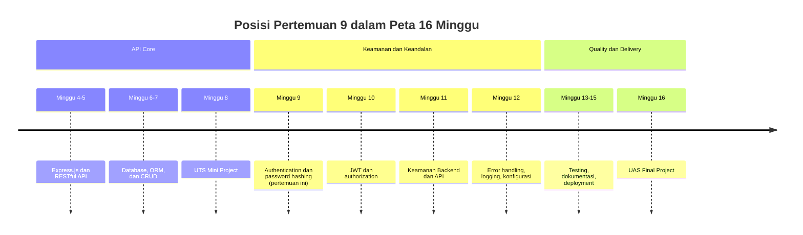
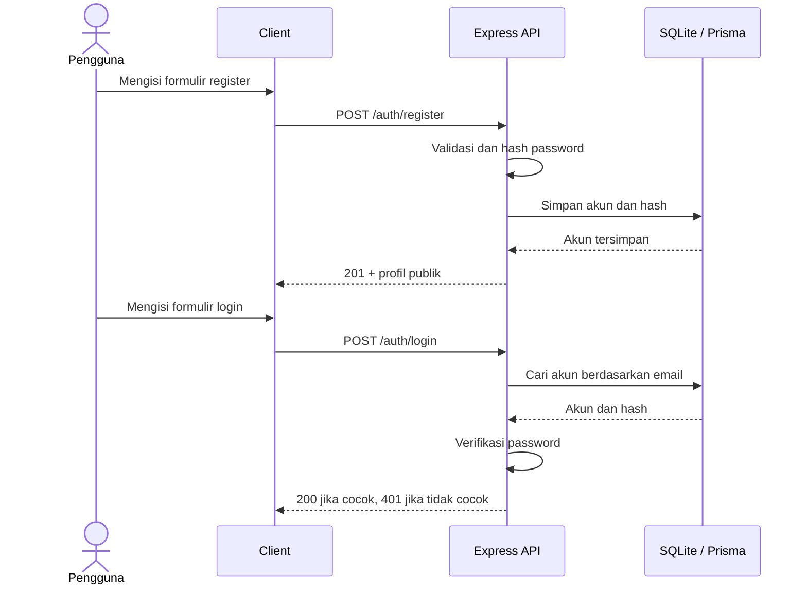

# Pertemuan 9 — Authentication: Register, Login, dan Password Hashing

| | |
|:--|:--|
| **Minggu** | 9 |
| **Tanggal** | Senin, 9 November 2026 (SI-VA) / Selasa, 10 November 2026 (SI-VB) |
| **CPMK** | CPMK118 |
| **Model Pembelajaran** | Case Based Learning / Problem Based Learning |
| **Stack** | Node.js 22.12+, Express.js 5, Prisma ORM 7, SQLite, TypeScript |

> **Catatan penting:** Pertemuan ini membahas authentication, yaitu proses memverifikasi identitas pengguna. Anda akan menyusun endpoint register dan login, menyimpan password dalam bentuk hash, serta membandingkan session dan token. Authentication berbeda dari authorization: middleware untuk melindungi endpoint dan pemeriksaan hak akses dibahas pada Pertemuan 10. Contoh praktikum menggunakan `scrypt` dari `node:crypto`; penerapan production memerlukan pengendalian tambahan seperti rate limiting, pengelolaan secret, dan proses pemulihan akun.

---

## Daftar Isi

- [Pertemuan 9 — Authentication: Register, Login, dan Password Hashing](#pertemuan-9--authentication-register-login-dan-password-hashing)
  - [Daftar Isi](#daftar-isi)
  - [1. Keterkaitan Pertemuan dengan RPS OBE](#1-keterkaitan-pertemuan-dengan-rps-obe)
  - [2. Capaian Pembelajaran Pertemuan](#2-capaian-pembelajaran-pertemuan)
  - [3. Pemantik Kasus: Perlindungan Kredensial Pengguna](#3-pemantik-kasus-perlindungan-kredensial-pengguna)
  - [4. Identity, Authentication, dan Authorization](#4-identity-authentication-dan-authorization)
  - [5. Siklus Hidup Kredensial](#5-siklus-hidup-kredensial)
  - [6. Password Hashing](#6-password-hashing)
  - [7. Endpoint Register](#7-endpoint-register)
  - [8. Endpoint Login](#8-endpoint-login)
  - [9. Session dan Token](#9-session-dan-token)
  - [10. Alur Authentication](#10-alur-authentication)
  - [11. Penerapan pada Express.js](#11-penerapan-pada-expressjs)
  - [12. Validasi dan Response](#12-validasi-dan-response)
  - [13. Case Based Learning: Studi Kasus Authentication](#13-case-based-learning-studi-kasus-authentication)
  - [14. Alur Demonstrasi dan Pengujian Endpoint](#14-alur-demonstrasi-dan-pengujian-endpoint)
  - [15. Tinjauan Keputusan Desain](#15-tinjauan-keputusan-desain)
  - [16. Kesalahan Umum](#16-kesalahan-umum)
  - [17. Batasan Implementasi](#17-batasan-implementasi)
  - [18. Aktivitas Kelompok](#18-aktivitas-kelompok)
  - [19. Latihan Individu](#19-latihan-individu)
  - [20. Pemanfaatan AI sebagai Coding Assistant](#20-pemanfaatan-ai-sebagai-coding-assistant)
  - [21. Kuis Formatif](#21-kuis-formatif)
  - [22. Output Pembelajaran — Tugas Authentication](#22-output-pembelajaran--tugas-authentication)
    - [Cara Pengumpulan — Push ke Repository GitHub Kelas](#cara-pengumpulan--push-ke-repository-github-kelas)
  - [23. Rubrik Tugas Authentication](#23-rubrik-tugas-authentication)
  - [24. Persiapan menuju Pertemuan 10](#24-persiapan-menuju-pertemuan-10)
  - [Lampiran: Kode Referensi](#lampiran-kode-referensi)

---

## 1. Keterkaitan Pertemuan dengan RPS OBE

Pertemuan 9 memulai fase **Keamanan & Keandalan** dan mendukung CPMK118: mahasiswa mampu menerapkan authentication dan authorization, mengamankan API, serta membangun error handling dan konfigurasi terpusat. Kemampuan Express.js, validasi, pola service/controller, dan database dari Pertemuan 4–8 digunakan kembali untuk mengelola akun.



## 2. Capaian Pembelajaran Pertemuan

| No. | Kemampuan | Indikator |
| :-: | --------- | --------- |
| 1 | Membedakan identity, authentication, dan authorization | Menjelaskan fungsi setiap konsep pada alur API |
| 2 | Menyusun endpoint register yang tervalidasi | Endpoint menolak field wajib yang kosong dan nilai dengan format yang tidak valid |
| 3 | Menyimpan password menggunakan password hashing | Database tidak menyimpan password asli |
| 4 | Menyusun endpoint login | Kredensial valid diterima, sedangkan kredensial yang salah menghasilkan response yang aman |
| 5 | Membandingkan session dan token | Menjelaskan lokasi state, pengiriman, dan konsekuensi masing-masing |
| 6 | Memilih status code yang sesuai | Menggunakan `201`, `400`, `401`, dan `409` sesuai kondisi |

## 3. Pemantik Kasus: Perlindungan Kredensial Pengguna

Sebuah layanan akademik menyimpan akun mahasiswa di tabel pengguna. Versi awal aplikasi menyimpan email dan password dalam bentuk teks biasa. Saat salinan database dibagikan untuk pengujian, tim menyadari bahwa siapa pun yang dapat membaca file tersebut dapat melihat kredensial.

Diskusikan: apakah menyembunyikan password pada halaman login melindungi data tersimpan? Jika database terbaca pihak lain, informasi apa yang dapat disalahgunakan? Mengapa response login sebaiknya tidak menjelaskan apakah email atau password yang salah? Bagaimana request berikutnya mengenali pengguna yang sudah login?

## 4. Identity, Authentication, dan Authorization

- **Identity** adalah informasi yang merujuk pada akun, misalnya ID atau email.
- **Authentication** memverifikasi identitas melalui bukti kredensial, misalnya password.
- **Authorization** menentukan tindakan yang boleh dilakukan oleh akun yang telah dikenali.

Urutannya adalah identifikasi akun, verifikasi kredensial, pembentukan konteks login, lalu pemeriksaan hak akses. Pertemuan ini berfokus pada verifikasi kredensial; middleware authentication dan authorization diterapkan pada Pertemuan 10.

## 5. Siklus Hidup Kredensial

| Tahap | Tindakan server | Hasil |
|:------|:----------------|:------|
| Register | Validasi body, buat salt, hitung hash, simpan akun | Profil publik; password dan hash tidak dikirim |
| Login | Cari akun, hitung ulang derived key, bandingkan hasil | Profil publik jika cocok; `401` jika tidak |
| Operasi data | Ambil field yang diperlukan saja dari database | Kredensial tidak bocor ke response atau log |

## 6. Password Hashing

Hashing bukan enkripsi. Enkripsi dapat dibalik dengan kunci, sedangkan hash satu arah digunakan untuk memverifikasi input tanpa menyimpan password aslinya. Gunakan algoritma khusus password seperti `scrypt`, `bcrypt`, atau `Argon2`, bukan hash cepat umum seperti `SHA-256(password)`.

```typescript
import { randomBytes, scrypt as scryptCallback } from "node:crypto";

const salt = randomBytes(16);
// Salt unik membuat password sama menghasilkan hash tersimpan yang berbeda.
```

Praktikum menyimpan hash dengan format `scrypt$<salt-hex>$<derived-key-hex>`. Saat login, server memakai salt tersimpan untuk menghitung ulang derived key, lalu membandingkannya menggunakan `timingSafeEqual`. Salt bukan secret dan disimpan bersama hash.

## 7. Endpoint Register

```http
POST /auth/register
Content-Type: application/json

{"nama":"Ayu Lestari","email":"ayu@example.test","password":"password-kuat-123"}
```

Server memastikan body berupa object JSON, lalu memeriksa nama, email, format email, panjang minimum password, dan keunikan email. Unique constraint database tetap diperlukan karena validasi aplikasi tidak mencegah dua request bersamaan membuat akun dengan email yang sama. Pembuatan akun yang berhasil menghasilkan `201 Created` dan hanya mengembalikan profil publik.

## 8. Endpoint Login

```http
POST /auth/login
Content-Type: application/json

{"email":"ayu@example.test","password":"password-kuat-123"}
```

Kredensial yang benar menghasilkan `200 OK`. Email yang tidak ditemukan dan password yang salah menghasilkan pesan `401 Unauthorized` yang sama untuk mengurangi kebocoran informasi akun. Contoh praktikum belum menerbitkan session ID atau JWT; materi ini berfokus pada verifikasi kredensial sebelum token diperkenalkan pada Pertemuan 10.

## 9. Session dan Token

| Aspek | Session | Token |
|:------|:--------|:------|
| State authentication | Disimpan server | Klaim dibawa token dan diverifikasi sesuai jenis token |
| Identitas request | Umumnya cookie berisi session ID | Umumnya header `Authorization: Bearer ...` |
| Penghentian akses | Session dapat dihapus di server | Token yang berdiri sendiri berlaku sampai kedaluwarsa kecuali ada mekanisme pencabutan |
| Risiko yang dikelola | Penyimpanan session, cookie, CSRF, skala server | Masa berlaku, penyimpanan client, signature/secret, pencabutan |

Keduanya mempertahankan konteks setelah login, bukan pengganti password hashing. Cookie perlu atribut seperti `HttpOnly`, `Secure` pada HTTPS, dan `SameSite`. Token juga harus dilindungi dari pencurian dan risiko XSS. JWT dibahas pada Pertemuan 10.

## 10. Alur Authentication



## 11. Penerapan pada Express.js

Project mengikuti pola dari pertemuan sebelumnya:

```text
request → auth.routes.ts → auth.controller.ts → auth.service.ts → Prisma → SQLite
```

Route memetakan endpoint, controller memvalidasi request dan menentukan status serta response, sedangkan service mengelola hash dan operasi database. Controller mengembalikan profil publik, bukan seluruh record pengguna. Database memberlakukan unique constraint pada email.

## 12. Validasi dan Response

| Kondisi | Status | Alasan |
|:--------|:------:|:-------|
| Akun berhasil dibuat | `201` | Resource baru tersimpan |
| Input tidak valid | `400` | Request tidak memenuhi kontrak endpoint |
| Email telah terdaftar | `409` | Konflik terhadap resource yang ada |
| Login gagal | `401` | Kredensial tidak membuktikan identitas |
| Error tak terduga | `500` | Server gagal memproses request |

Password dan hash tidak boleh dicantumkan dalam response atau log. Data dari body diperlakukan sebagai `unknown` dan tipe diperiksa sebelum nilai digunakan.

## 13. Case Based Learning: Studi Kasus Authentication

Kasus: layanan peminjaman laboratorium perlu membatasi fitur administrasi untuk staf, tetapi seluruh pengguna dapat melihat katalog alat. Mini project sudah memiliki model `Pengguna`, tetapi belum mendukung login. Tentukan field akun, kontrak register/login, validasi, response aman, dan konsekuensi session atau token. Pisahkan authentication dari aturan role yang dibahas minggu depan.

## 14. Alur Demonstrasi dan Pengujian Endpoint

Kode praktikum ada pada [`code/pertemuan-09/`](../code/pertemuan-09/). Dari direktori tersebut jalankan:

```bash
npm install
cp .env.example .env
npx prisma migrate dev --name init
npx prisma generate
npm start
```

Server memakai port `3009`. Uji alur register, login benar, login salah, input tidak valid, dan email duplikat:

```bash
curl -i -X POST http://localhost:3009/auth/register -H "Content-Type: application/json" -d '{"nama":"Ayu Lestari","email":"ayu@example.test","password":"password-kuat-123"}'
curl -i -X POST http://localhost:3009/auth/login -H "Content-Type: application/json" -d '{"email":"ayu@example.test","password":"password-kuat-123"}'
curl -i -X POST http://localhost:3009/auth/login -H "Content-Type: application/json" -d '{"email":"ayu@example.test","password":"salah-password"}'
```

Periksa response dan tabel pengguna. Nilai pada kolom `passwordHash` harus berisi format `scrypt$salt$derivedKey`, bukan password yang dikirim.

## 15. Tinjauan Keputusan Desain

- Salt acak per akun mencegah password sama menghasilkan hash tersimpan yang sama.
- `timingSafeEqual` membandingkan derived key; panjang buffer diperiksa sebelum fungsi dipanggil.
- Unique constraint database melindungi dari request register bersamaan.
- Pesan login umum mengurangi kebocoran informasi keberadaan email.
- Pemilihan field publik mencegah hash ikut terkirim tanpa sengaja.

## 16. Kesalahan Umum

1. Menyimpan atau mencatat password asli.
2. Menggunakan hash cepat umum tanpa salt khusus password.
3. Mengirim seluruh record pengguna dari Prisma ke client.
4. Memberikan pesan berbeda untuk email yang tidak terdaftar dan password salah.
5. Menganggap authentication otomatis memberikan hak akses.
6. Menganggap token mandiri selalu dapat dicabut seketika.
7. Mengandalkan pemeriksaan controller tanpa unique constraint database.

## 17. Batasan Implementasi

Project referensi memakai SQLite lokal, aturan password minimum untuk pembelajaran, dan belum membatasi laju login. Belum tersedia verifikasi email, reset password, MFA, session store, cookie authentication, atau JWT. Jangan memakai project ini sebagai layanan production tanpa threat modeling, pengujian, konfigurasi keamanan, dan penyimpanan yang sesuai.

## 18. Aktivitas Kelompok

Rancang alur register dan login untuk domain kelompok. Buat tabel input, validasi, operasi database, response sukses, dan response gagal. Tukarkan rancangan untuk meninjau potensi kebocoran password/hash, email duplikat, pesan login, serta pencampuran authentication dengan authorization.

## 19. Latihan Individu

1. Tambahkan `nim` sebagai identitas unik kedua dan validasi formatnya.
2. Uji login benar/salah, email tidak terdaftar, serta tipe field keliru.
3. Jelaskan mengapa hash tidak boleh menjadi pengganti password pada response.
4. Gambar sequence pembuatan salt dan verifikasi login.

## 20. Pemanfaatan AI sebagai Coding Assistant

**Gunakan AI untuk:**

- Meminta penjelasan perbedaan hashing dan enkripsi, fungsi salt, serta proses verifikasi `scrypt`.
- Meminta tinjauan alur password dari request hingga database dan memeriksa apakah response membocorkan field sensitif.
- Menyusun daftar skenario uji register/login, termasuk kredensial salah, input tidak valid, dan email duplikat.

**Jangan gunakan AI untuk:**

- Mengirim password nyata, secret, file `.env`, data pribadi, atau file database.
- Menghasilkan seluruh authentication flow tanpa memahami tanggung jawab route, controller, dan service.
- Menganggap saran AI sebagai bukti keamanan atau melewatkan pengujian kode.

**Etika di kelas:**

1. Cantumkan penggunaan AI pada README atau refleksi tugas dan jelaskan saran yang diterapkan.
2. Verifikasi saran menggunakan dokumentasi Node.js dan hasil pengujian endpoint.
3. Anda tetap bertanggung jawab menjelaskan serta menguji keputusan keamanan yang digunakan.

## 21. Kuis Formatif

1. Apa perbedaan authentication dan authorization?
2. Apa fungsi salt pada password hashing?
3. Mengapa password tidak disimpan sebagai plaintext?
4. Mengapa kegagalan login sebaiknya memakai pesan umum?
5. Sebutkan satu perbedaan session dan token.

## 22. Output Pembelajaran — Tugas Authentication

Tambahkan `POST /auth/register` dan `POST /auth/login` pada mini project. Gunakan password hashing yang sesuai, unique constraint untuk email, validasi tipe dan format, serta response tanpa password/hash.

### Cara Pengumpulan — Push ke Repository GitHub Kelas

| Kelas | Repository | Folder |
|:------|:-----------|:-------|
| SI-VA | `SI-VA-Backend` | `uts/<nim>-<nama>/` |
| SI-VB | `SI-VB-Backend` | `uts/<nim>-<nama>/` |

Langkah pengumpulan:

1. Buat branch menggunakan NIM Anda.
2. Perbarui mini project pada folder `uts/<nim>-<nama>/` yang dikumpulkan pada Pertemuan 8.
3. Jalankan `npm install`, `npx prisma migrate dev`, dan `npx prisma generate` sesuai README project.
4. Uji endpoint register dan login; catat hasil pengujian berhasil, kredensial salah, input tidak valid, dan email duplikat pada README.
5. Commit dan push branch, lalu buat Pull Request.

Pastikan `node_modules/`, `.env`, dan file database `.db` tidak ikut di-commit. Tambahkan pola berikut pada `.gitignore` bila belum tersedia:

```gitignore
node_modules/
.env
prisma/dev.db
prisma/generated/
```

> **Catatan:** File `prisma/generated/` adalah hasil `prisma generate` dan tidak perlu di-commit. File `prisma/migrations/` harus di-commit agar database dapat di-migrate ulang di komputer lain.

## 23. Rubrik Tugas Authentication

| Komponen | Bobot | Indikator |
|:---------|------:|:----------|
| Register dan validasi input | 25% | Input tidak valid ditolak dengan status sesuai |
| Password hashing dan penyimpanan | 30% | Password asli tidak tersimpan/dikirim; hash memakai salt |
| Login dan response aman | 25% | Kredensial diverifikasi; kegagalan tidak membocorkan keberadaan akun |
| Integrasi database dan dokumentasi | 20% | Unique constraint, README, dan bukti pengujian tersedia |
| **Total** | **100%** | |

> Penilaian setiap komponen memakai skala 0–4. Nilai akhir = **Σ(bobot × skor) / 4**, dengan bobot berupa proporsi (misalnya 25% = 0,25). Rumus ini menghasilkan nilai 0–100.

## 24. Persiapan menuju Pertemuan 10

Pertemuan berikutnya membahas JWT dan authorization. Tinjau kembali proses verifikasi password dan alasan login perlu membentuk konteks yang dapat dikirim pada request selanjutnya. Bawa mini project UTS yang dapat dijalankan.

## Lampiran: Kode Referensi

Kode lengkap tersedia pada [`code/pertemuan-09/`](../code/pertemuan-09/).

| File | Tujuan |
|:-----|:-------|
| `src/service/auth.service.ts` | Membuat salt, menghitung hash, memverifikasi password, dan mengakses Prisma |
| `src/controller/auth.controller.ts` | Memvalidasi body serta membentuk response/status |
| `src/routes/auth.routes.ts` | Memetakan endpoint register dan login |
| `prisma/schema.prisma` | Model akun dengan email unik |
| `app.ts` / `server.ts` | Middleware Express dan proses server |
