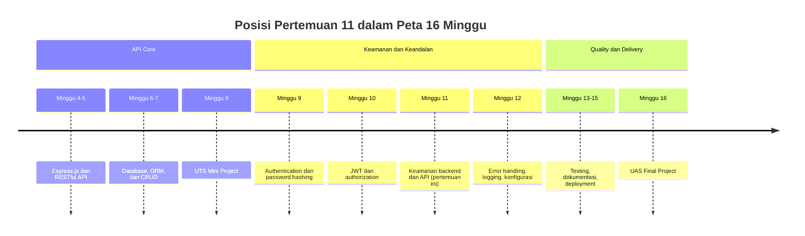

# Pertemuan 11 — Keamanan Backend dan API

| | |
|:--|:--|
| **Minggu** | 11 |
| **Tanggal** | Senin, 23 November 2026 (SI-VA) / Selasa, 24 November 2026 (SI-VB) |
| **CPMK** | CPMK118 |
| **Model Pembelajaran** | Case Based Learning / Problem Based Learning |
| **Stack** | Node.js 22.12+, Express.js 5, Prisma ORM 7, SQLite, helmet, cors, express-rate-limit, TypeScript |

> **Catatan penting:** Pada Pertemuan 9, Anda membangun endpoint register dan login. Pada Pertemuan 10, Anda melindungi endpoint dengan authentication dan authorization. Pertemuan ini melanjutkan pengamanan API melalui validasi masukan, konfigurasi yang tepat, dan pembatasan jumlah request. Anda akan menerapkan input validation, memahami fungsi query terparameterisasi, memasang security header, membatasi CORS, serta menerapkan rate limiting. Semua mekanisme tersebut merupakan lapisan dasar dan bukan jaminan keamanan menyeluruh.

---

## Daftar Isi

- [Pertemuan 11 — Keamanan Backend dan API](#pertemuan-11--keamanan-backend-dan-api)
  - [Daftar Isi](#daftar-isi)
  - [1. Keterkaitan Pertemuan dengan RPS OBE](#1-keterkaitan-pertemuan-dengan-rps-obe)
  - [2. Capaian Pembelajaran Pertemuan](#2-capaian-pembelajaran-pertemuan)
  - [3. Pemantik Kasus: API yang Bocor dan Lambat](#3-pemantik-kasus-api-yang-bocor-dan-lambat)
  - [4. Peta Risiko pada API](#4-peta-risiko-pada-api)
  - [5. Prinsip Keamanan pada Backend](#5-prinsip-keamanan-pada-backend)
  - [6. Input Validation](#6-input-validation)
  - [7. SQL Injection dan Query Terparameterisasi](#7-sql-injection-dan-query-terparameterisasi)
  - [8. Error Handling tanpa Kebocoran](#8-error-handling-tanpa-kebocoran)
  - [9. Security Header](#9-security-header)
  - [10. CORS](#10-cors)
  - [11. Rate Limiting](#11-rate-limiting)
  - [12. Secret Management](#12-secret-management)
  - [13. Security Checklist](#13-security-checklist)
  - [14. Alur Demonstrasi dan Pengujian Keamanan](#14-alur-demonstrasi-dan-pengujian-keamanan)
  - [15. Tinjauan Keputusan Desain](#15-tinjauan-keputusan-desain)
  - [16. Kesalahan Umum](#16-kesalahan-umum)
  - [17. Batasan Implementasi](#17-batasan-implementasi)
  - [18. Aktivitas Kelompok](#18-aktivitas-kelompok)
  - [19. Latihan Individu](#19-latihan-individu)
  - [20. Pemanfaatan AI sebagai Coding Assistant](#20-pemanfaatan-ai-sebagai-coding-assistant)
  - [21. Kuis Formatif](#21-kuis-formatif)
  - [22. Output Pembelajaran — Tugas Keamanan API](#22-output-pembelajaran--tugas-keamanan-api)
    - [Cara Pengumpulan — Push ke Repository GitHub Kelas](#cara-pengumpulan--push-ke-repository-github-kelas)
  - [23. Rubrik Tugas Keamanan API](#23-rubrik-tugas-keamanan-api)
  - [24. Persiapan menuju Pertemuan 12](#24-persiapan-menuju-pertemuan-12)
  - [Lampiran: Kode Referensi](#lampiran-kode-referensi)

---

## 1. Keterkaitan Pertemuan dengan RPS OBE

Pertemuan 11 tetap berada pada fase **Keamanan & Keandalan** dan mendukung CPMK118: mahasiswa mampu menerapkan authentication dan authorization, mengamankan API, serta membangun error handling dan konfigurasi terpusat.



## 2. Capaian Pembelajaran Pertemuan

| No. | Kemampuan | Indikator |
| :-: | --------- | --------- |
| 1 | Mengidentifikasi risiko pada API | Menjelaskan risiko utama dalam project kelompok |
| 2 | Menerapkan input validation | Body, query, dan parameter diperiksa berdasarkan tipe, format, serta batas panjangnya |
| 3 | Menjelaskan fungsi query terparameterisasi | Input pengguna tidak disisipkan langsung ke teks SQL |
| 4 | Memasang security header | Respons membawa header yang mengurangi risiko serangan melalui browser |
| 5 | Membatasi CORS | Hanya origin terdaftar yang mendapat izin akses |
| 6 | Menerapkan rate limiting | Request berlebihan ditolak dengan `429` |
| 7 | Mengelola secret melalui environment | Kredensial tidak ditulis langsung di dalam kode |

## 3. Pemantik Kasus: API yang Bocor dan Lambat

Sebuah layanan peminjaman buku sudah dapat diakses publik. Pada minggu pertama, seorang pengguna mencoba mengirim `judul=' OR '1'='1` pada parameter pencarian dan menerima seluruh daftar buku. Pada minggu kedua, server berhenti merespons selama beberapa detik karena satu client mengirim ribuan request dalam waktu singkat. Kedua kejadian tersebut menunjukkan bahwa API perlu memvalidasi masukan sekaligus membatasi jumlah request.

Diskusikan: mengapa `helmet` tidak mencegah kebocoran data? Mengapa `cors` bukan mekanisme keamanan? Apa perbedaan SQL injection dengan kelemahan lain yang tidak dapat diatasi hanya dengan memfilter input?

## 4. Peta Risiko pada API

| Risiko | Manifestasi | Mitigasi dasar |
|:-------|:------------|:---------------|
| SQL injection | Masukan pengguna mengubah struktur query SQL | Query terparameterisasi melalui ORM |
| Broken access control | Endpoint terbuka untuk semua | Middleware authentication dan authorization |
| Injection | Masukan ditafsirkan sebagai bagian dari query atau perintah | Validasi tipe, format, dan panjang |
| Error disclosure | Pesan internal bocor ke client | Error handler terpusat |
| Resource exhaustion | Request berulang menghabiskan CPU dan memori | Rate limiting dan batas ukuran body |
| Secret terekspos | Kredensial tersimpan di repository | Environment variable dan `.gitignore` |
| Cross-origin abuse | Situs lain memakai API Anda | CORS selektif |
| Clickjacking | Halaman Anda dibungkus situs lain | `X-Frame-Options` atau CSP |

## 5. Prinsip Keamanan pada Backend

- **Validasi di server.** Request dari client dapat diubah; periksa kembali setiap nilai yang diterima.
- **Gunakan pustaka yang teruji.** `helmet`, `cors`, dan `express-rate-limit` membantu menangani kebutuhan keamanan umum.
- **Tolak input di luar kontrak.** Kembalikan `400`; jangan mengubah masukan secara diam-diam.
- **Jangan mengandalkan kontrol pada client.** Menyembunyikan tombol pada frontend bukan pembatasan akses.
- **Pisahkan error internal dari error eksternal.** Detail kegagalan hanya untuk log server.

## 6. Input Validation

Validasi memeriksa nilai sebelum digunakan. Pemeriksaan mencakup tipe, format, serta batas panjang atau rentang yang diizinkan.

```typescript
const stokMentah = record.stok;
let stok = 0;
if (stokMentah === undefined) {
  stok = 0;
} else if (typeof stokMentah !== "number" || !Number.isSafeInteger(stokMentah) || stokMentah < 0 || stokMentah > 2_147_483_647) {
  errors.push("stok harus berupa bilangan bulat non-negatif");
} else {
  stok = stokMentah;
}
```

Nilai query dapat berupa string, array, atau object, bergantung pada struktur parameter. Periksa tipenya sebelum mengonversi nilai menjadi angka:

```typescript
const stokMentah = request.query.minStok;
if (typeof stokMentah !== "string" || stokMentah === "" || !/^\d+$/.test(stokMentah)) {
  errors.push("minStok harus berupa bilangan bulat non-negatif");
} else {
  hasil.minStok = Number(stokMentah);
}
```

`Number.isInteger` menolak `NaN` dan bilangan pecahan. Menolak input yang tidak sesuai kontrak pada batas API lebih aman daripada mengubahnya secara diam-diam.

## 7. SQL Injection dan Query Terparameterisasi

SQL injection terjadi ketika masukan pengguna masuk ke dalam teks query dan mengubah strukturnya. Contoh berbahaya:

```typescript
// BERBAHAYA — string digabungkan langsung ke query.
const hasil = await prisma.$queryRawUnsafe(
  `SELECT * FROM buku WHERE judul = '${judulPengguna}'`
);
```

ORM mengirim query terparameterisasi, sehingga nilai dikirim terpisah dari teks query dan tidak dapat mengubah strukturnya:

```typescript
// AMAN — nilai dikirim sebagai parameter.
const buku = await prisma.buku.findMany({
  where: { judul: { contains: judulPengguna } },
});
```

Escaping manual dengan `replace()` atau pengubahan tanda kutip tidak menggantikan parameterisasi karena mudah melewatkan kasus tertentu. Gunakan API parameter dari driver atau ORM.

## 8. Error Handling tanpa Kebocoran

Pesan error dari database dapat memuat nama kolom, nama berkas, atau potongan kredensial. Error handler memetakan kegagalan menjadi pesan umum dan menulis detail lengkap hanya ke log:

```typescript
app.use((error: Error, request: Request, response: Response, _next: (error?: unknown) => void) => {
  const id = (request as RequestBerId).requestId ?? "-";
  console.error(`[${id}] Kesalahan aplikasi:`, error.message);
  response.status(500).json({ success: false, message: "Terjadi kesalahan pada server" });
});
```

`X-Request-Id` menghubungkan pesan log dengan request tertentu sehingga mudah ditelusuri tanpa mengirim detail internal ke client.

## 9. Security Header

Header keamanan memberi instruksi kepada browser tentang cara menangani konten dari server. `helmet` memasang beberapa header sekaligus:

| Header | Fungsi |
|:-------|:-------|
| `X-Content-Type-Options: nosniff` | Mencegah browser menebak tipe konten |
| `X-Frame-Options: SAMEORIGIN` | Mencegah halaman dibungkus frame situs lain |
| `Content-Security-Policy` | Membatasi sumber daya yang boleh dimuat |
| `Strict-Transport-Security` | Memaksa HTTPS pada browser yang mendukung |
| `Referrer-Policy: no-referrer` | Mencegah URL menjadi `Referer` ke situs lain |
| `X-DNS-Prefetch-Control: off` | Mengatur agar browser tidak melakukan DNS prefetch |

Header dipasang paling awal pada rantai middleware agar respons `404` dan `500` juga membawa header yang sama.

## 10. CORS

CORS (Cross-Origin Resource Sharing) adalah mekanisme browser yang menentukan apakah halaman dari satu origin boleh membaca response dari origin lain. CORS tidak menentukan hak akses pengguna; mekanisme ini hanya memberi instruksi kepada browser.

```typescript
export const corsTerbatas = cors({
  origin: (origin, callback) => {
    const daftarIzin = (process.env.CORS_ORIGIN ?? "")
      .split(",")
      .map((item) => item.trim())
      .filter((item) => item.length > 0);

    // Request tanpa Origin (misalnya dari curl atau Postman) tidak melewati aturan browser.
    if (!origin) {
      callback(null, true);
      return;
    }
    callback(null, daftarIzin.includes(origin));
  },
});
```

Untuk origin yang tidak terdaftar, server tidak mengirim header `Access-Control-Allow-Origin`, sehingga browser memblokir pembacaan response. Request tetap sampai ke server. Karena itu, CORS bukan pengganti autentikasi atau pembatasan laju.

## 11. Rate Limiting

Rate limiting membatasi jumlah request dari satu sumber dalam rentang waktu tertentu. Tujuannya adalah mencegah satu client menghabiskan sumber daya server dengan mengirim terlalu banyak request.

```typescript
export const pembatasiRequest = rateLimit({
  windowMs: bacaAngka("RATE_LIMIT_WINDOW_MS", 15_000),
  limit: bacaAngka("RATE_LIMIT_MAX", 20),
  standardHeaders: "draft-7",
  legacyHeaders: false,
  message: { success: false, message: "Terlalu banyak permintaan, coba lagi nanti" },
});
```

Opsi `standardHeaders: "draft-7"` mengirim header `RateLimit` agar client dapat mengetahui batas request. Pada aplikasi nyata, endpoint autentikasi perlu memiliki batas yang lebih ketat karena sering menjadi target serangan tebak password. Terapkan pembatasan juga pada reverse proxy atau API gateway, bukan hanya pada proses aplikasi.

## 12. Secret Management

Secret adalah nilai yang tidak boleh diketahui pihak lain: password database, kunci privat, dan `JWT_SECRET`. Aturannya sederhana: secret dibaca dari environment, tidak ditulis di dalam kode, dan tidak ikut ter-*commit*.

```dotenv
DATABASE_URL="file:./prisma/dev.db"
CORS_ORIGIN="http://localhost:5173"
```

Berkas `.env` tidak ikut di-*commit*, sedangkan `.env.example` menjelaskan bentuk konfigurasi tanpa nilai rahasia. Untuk layanan production, secret berasal dari secret manager atau variabel lingkungan yang dikelola platform, bukan dari berkas di dalam repository.

## 13. Security Checklist

Gunakan daftar berikut saat meninjau project:

- [ ] Semua endpoint `write` memvalidasi body: tipe, panjang, dan format.
- [ ] Semua parameter dan query divalidasi sebelum dipakai.
- [ ] Tidak ada penggabungan input pengguna ke teks SQL.
- [ ] Endpoint sensitif memakai autentikasi dan authorization dari Pertemuan 10.
- [ ] `helmet` terpasang sebelum route.
- [ ] CORS memakai daftar origin, bukan `origin: true`.
- [ ] Rate limiting terpasang, dengan batas lebih ketat pada endpoint autentikasi.
- [ ] Batas ukuran body ditetapkan pada `express.json()`.
- [ ] Error handler tidak mengirim pesan internal.
- [ ] Tidak ada secret di dalam kode atau repository.
- [ ] `.env`, `node_modules/`, dan `prisma/dev.db` tidak ter-*commit*.

## 14. Alur Demonstrasi dan Pengujian Keamanan

Kode praktikum ada pada [`code/pertemuan-11/`](../code/pertemuan-11/). Contoh ini sengaja memusatkan pembahasan pada hardening API; route buku masih publik dan belum memasang middleware authentication atau authorization dari Pertemuan 10. Pada mini project, pasang middleware tersebut terutama pada endpoint yang mengubah data sebelum digunakan di layanan nyata. Dari direktori tersebut jalankan:

```bash
npm install
cp .env.example .env
npx prisma migrate dev --name init
npx prisma generate
npm start
```

Server memakai port `3011`. Periksa security header pada respons:

```bash
curl -i http://localhost:3011/health
```

Uji validasi body dan query:

```bash
curl -i -X POST http://localhost:3011/api/buku -H "Content-Type: application/json" -d '{"judul":"Clean Code","penulis":"Robert Martin","stok":5}'
curl -i -X POST http://localhost:3011/api/buku -H "Content-Type: application/json" -d '{"judul":"","penulis":"X","stok":-1}'
curl -i "http://localhost:3011/api/buku?minStok=abc"
curl -i "http://localhost:3011/api/buku?minStok=999999999999999999999999"
curl -i -X POST http://localhost:3011/api/buku -H "Content-Type: application/json" -d '{"judul":"Batas","penulis":"Uji","stok":2147483648}'
curl -i -X POST http://localhost:3011/api/buku -H "Content-Type: application/json" -d '{broken'
curl -i "http://localhost:3011/api/buku?minStok=1&judul=Clean"
```

Uji CORS dengan dua origin berbeda:

```bash
curl -i -H "Origin: http://localhost:5173" http://localhost:3011/health
curl -i -H "Origin: https://evil.test" http://localhost:3011/health
```

Uji rate limiting dengan mengirim permintaan berulang:

```bash
for i in $(seq 1 26); do curl -s -o /dev/null -w "%{http_code} " http://localhost:3011/health; done
```

Ringkasan hasil yang diharapkan:

| Skenario | Hasil |
|:---------|:------|
| `GET /health` | 200 dengan header keamanan dan `X-Request-Id` |
| `POST /api/buku` dengan body lengkap | 201 |
| `POST /api/buku` dengan body tidak valid | 400 |
| `GET /api/buku?minStok=abc` | 400 |
| Query `minStok` di luar rentang integer database | 400 |
| `POST /api/buku` dengan stok di luar rentang integer database | 400 |
| `POST /api/buku` dengan JSON rusak | 400 |
| `POST /api/buku` dengan body lebih dari 100 KB | 413 |
| `GET /api/buku?minStok=1` | 200 |
| `GET /api/buku?minStok=1` dengan filter `judul` | 200 |
| `GET /tidak-ada` | 404 |
| Request dengan `Origin` terdaftar | Respons membawa `Access-Control-Allow-Origin` |
| Request dengan `Origin` tidak terdaftar | Tidak membawa header tersebut |
| Request melebihi batas laju | 429 dengan pesan JSON |

## 15. Tinjauan Keputusan Desain

- Query terparameterisasi melalui ORM menutup SQL injection tanpa menuliskan filter sendiri.
- Validasi query dipasang sebagai middleware agar semua handler memakai aturan yang sama.
- `helmet` dipasang paling awal agar respons error juga membawa header keamanan.
- CORS memakai daftar origin dari environment agar whitelist dapat diubah tanpa mengubah kode.
- Rate limit dibaca dari environment agar batas dapat disesuaikan per lingkungan.
- `X-Request-Id` menghubungkan log server dengan request tanpa mengirim detail internal ke client.
- Batas ukuran body `100kb` mencegah payload besar menghabiskan memori.

## 16. Kesalahan Umum

1. Menggabungkan input pengguna ke dalam teks SQL dengan template literal.
2. Memasang validasi hanya pada satu endpoint sehingga endpoint lain tetap terbuka.
3. Memakai `origin: true` pada konfigurasi CORS sehingga semua origin diizinkan.
4. Menganggap CORS sebagai mekanisme keamanan, padahal CORS hanya membatasi pembacaan di browser.
5. Menaruh `helmet` setelah route sehingga respons `404` dan `500` tidak membawa header keamanan.
6. Membiarkan `X-Powered-By` tetap aktif sehingga versi teknologi terkonfirmasi.
7. Mengirim pesan error database langsung kepada client.
8. Membebaskan ukuran body tanpa batas sehingga payload besar menghabiskan memori.
9. Menyimpan `JWT_SECRET` atau kredensial database di dalam kode.
10. Menguji keamanan hanya pada kasus berhasil tanpa menguji kasus penolakan.

## 17. Batasan Implementasi

Project referensi menggunakan SQLite lokal, daftar origin CORS yang dicantumkan pada `.env.example`, dan rate limiter yang menyimpan data hitungan di memori satu proses. Data tersebut tidak dibagikan antar-instance sehingga pendekatan ini tidak sesuai untuk penerapan dengan beberapa instance. Project ini belum mencakup WAF, pemeriksaan dependensi otomatis, deteksi anomali, `fail2ban`, atau pemantauan keamanan. Jangan gunakan contoh ini sebagai layanan production tanpa threat modeling, pengujian keamanan, dan pemantauan.

## 18. Aktivitas Kelompok

Susun security checklist untuk domain kelompok pada `README.md`. Untuk setiap item, tuliskan risiko yang dicegah, konfigurasi yang dipakai, serta perintah `curl` yang membuktikan penolakan terhadap aturan tersebut. Tukarkan checklist antarkelompok untuk menguji apakah setiap klaim keamanan benar-benar dapat dibuktikan.

## 19. Latihan Individu

1. Tambahkan batas laju yang lebih ketat pada endpoint `POST /api/buku` dan buktikan hasilnya.
2. Tambahkan validasi panjang minimal untuk `judul` dan uji kasus terlalu pendek.
3. Uji `Origin` yang tidak terdaftar dan catat header yang tidak dikirim server.
4. Jelaskan mengapa `helmet` tidak dapat mencegah SQL injection.
5. Tuliskan satu skenario yang tidak dapat diselesaikan oleh filter input dan jelaskan mitigasi yang tepat.

## 20. Pemanfaatan AI sebagai Coding Assistant

**Gunakan AI untuk:**

- Meminta penjelasan fungsi setiap security header yang dipasang `helmet`.
- Meminta tinjauan proyek Anda untuk mencari endpoint yang belum memvalidasi input.
- Menyusun skenario pengujian keamanan: input tidak valid, origin tidak terdaftar, dan request berlebihan.

**Jangan gunakan AI untuk:**

- Mengirim secret, file `.env`, token, atau data pribadi ke layanan AI.
- Menghasilkan kode keamanan tanpa memahami alasan setiap baris.
- Menganggap hasil pemeriksaan AI sebagai audit keamanan yang sahih.

**Etika di kelas:**

1. Cantumkan penggunaan AI pada README atau refleksi tugas dan jelaskan saran yang diterapkan.
2. Verifikasi setiap klaim keamanan dengan pengujian endpoint, bukan dengan pembacaan dokumentasi saja.
3. Anda tetap bertanggung jawab atas keputusan keamanan pada project Anda.

## 21. Kuis Formatif

1. Mengapa query terparameterisasi lebih aman dibandingkan penggabungan teks SQL?
2. Apa tugas utama security header terhadap browser?
3. Mengapa CORS bukan mekanisme keamanan?
4. Apa tujuan rate limiting pada endpoint login?
5. Mengapa error handler tidak boleh mengirim pesan error database kepada client?
6. Mengapa secret harus dibaca dari environment?

## 22. Output Pembelajaran — Tugas Keamanan API

Terapkan lapisan keamanan pada mini project kelompok: input validation konsisten, query terparameterisasi, `helmet`, CORS selektif, rate limiting, batas ukuran body, serta error handler yang tidak membocorkan detail internal.

### Cara Pengumpulan — Push ke Repository GitHub Kelas

| Kelas | Repository | Folder |
|:------|:-----------|:-------|
| SI-VA | `SI-VA-Backend` | `uts/<nim>-<nama>/` |
| SI-VB | `SI-VB-Backend` | `uts/<nim>-<nama>/` |

Langkah pengumpulan:

1. Buat branch menggunakan NIM Anda.
2. Perbarui mini project pada folder `uts/<nim>-<nama>/` yang dikumpulkan pada Pertemuan 8.
3. Jalankan `npm install`, `npx prisma migrate dev`, dan `npx prisma generate` sesuai README project.
4. Uji security header, validasi input, CORS untuk origin terdaftar dan tidak terdaftar, serta rate limiting; catat hasilnya pada README.
5. Commit dan push branch, lalu buat Pull Request.

Pastikan `node_modules/`, `.env`, dan file database `.db` tidak ikut di-*commit*. Tambahkan pola berikut pada `.gitignore` bila belum tersedia:

```gitignore
node_modules/
.env
prisma/dev.db
prisma/generated/
```

> **Catatan:** File `prisma/generated/` adalah hasil `prisma generate` dan tidak perlu di-*commit*. File `prisma/migrations/` harus di-*commit* agar database dapat di-migrate ulang di komputer lain.

## 23. Rubrik Tugas Keamanan API

| Kriteria | Bobot | 4 (Sangat Baik) | 3 (Baik) | 2 (Cukup) | 1 (Perlu Bimbingan) |
|:---------|:-----:|:----------------|:---------|:----------|:--------------------|
| Input validation | 25% | Body, query, dan parameter divalidasi tipe, format, dan panjang; kasus penolakan diuji | Validasi ada pada sebagian besar endpoint | Validasi hanya pada endpoint utama | Validasi hampir tidak ada |
| Pencegahan SQL injection | 20% | Seluruh query memakai API parameter ORM; tidak ada penggabungan input ke SQL | Mayoritas query aman | Ada satu query yang masih berisiko | Query digabungkan langsung dengan input |
| Security header dan CORS | 20% | `helmet` terpasang paling awal, CORS memakai daftar origin, keduanya dibuktikan pengujian | Header dan CORS terpasang | Hanya salah satu yang terpasang | Keduanya tidak terpasang |
| Rate limiting dan batas sumber daya | 15% | Rate limit terpasang dengan batas jelas, `429` terbukti, ukuran body dibatasi | Rate limit terpasang | Limitasi hanya satu sisi | Tidak ada limitasi |
| Secret management dan dokumentasi | 20% | Secret dari environment, `.env` diabaikan Git, README memuat checklist dan bukti uji | Secret dari environment, README cukup | Secret dari environment tanpa README lengkap | Secret di-hardcode di kode |

**Nilai akhir = Σ(bobot × skor) / 4 × 100**, dengan bobot berupa proporsi—misalnya 25% ditulis sebagai 0,25.

## 24. Persiapan menuju Pertemuan 12

Pertemuan berikutnya membahas error handling, logging, dan konfigurasi environment secara terpusat. Tinjau kembali bagaimana error ditangani pada project Anda: apakah setiap kegagalan menghasilkan pesan yang tepat, dan apakah detail internal hanya ditulis ke log. Bawa mini project yang sudah memiliki lapisan keamanan dasar.

## Lampiran: Kode Referensi

Kode lengkap tersedia pada [`code/pertemuan-11/`](../code/pertemuan-11/).

| File | Tujuan |
|:-----|:-------|
| `src/middleware/security.middleware.ts` | `helmet`, CORS selektif, rate limiting, dan `X-Request-Id` |
| `src/middleware/validation.middleware.ts` | Validasi query string sebelum controller |
| `src/controller/buku.controller.ts` | Validasi body dan pemilihan status code |
| `src/service/buku.service.ts` | Query terparameterisasi melalui Prisma |
| `src/routes/buku.routes.ts` | Memasangkan middleware validasi dengan route |
| `prisma/schema.prisma` | Model buku |
| `app.ts` / `server.ts` | Urutan middleware keamanan dan proses server |
